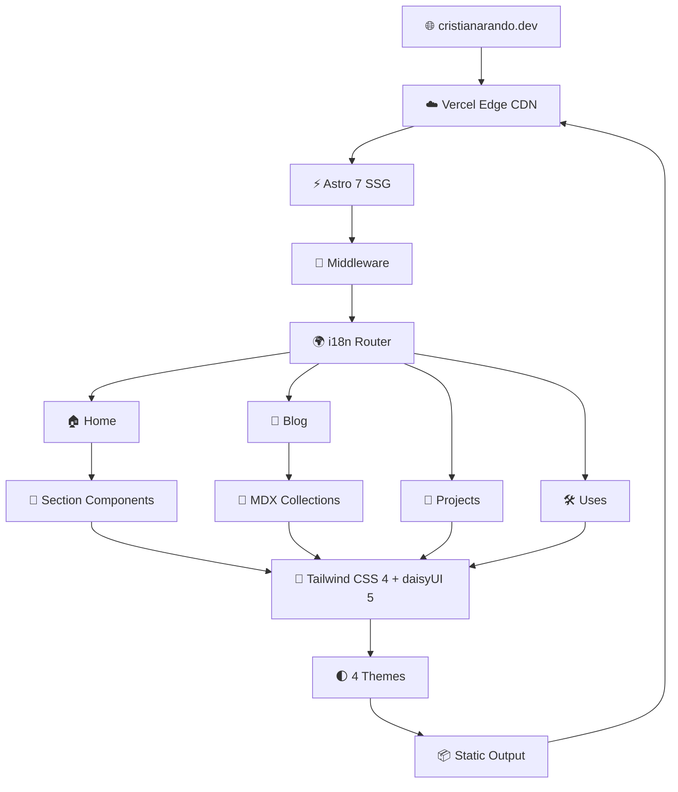

<div align="center">

# 🌐 cristianarando.dev

**Personal portfolio, blog & digital identity — built with Astro, Tailwind CSS & daisyUI.**


[](https://cristianarando.dev)
[](https://astro.build)
[](https://tailwindcss.com)
[](https://daisyui.com)
[](https://www.typescriptlang.org)
[](https://github.com/iamcristian/my-portfolio/actions)
[](./LICENSE)

<br>

<a href="https://cristianarando.dev">
  
</a>


<br>


<br>

[Test link](https://pagespeed.web.dev/analysis/https-cristianarando-dev/2z6eo1odfv?hl=en&form_factor=mobile/)

[Features](#-features) · [Tech Stack](#-tech-stack) · [Getting Started](#-getting-started) · [Project Structure](#-project-structure) · [Deployment](#-deployment) · [Contributing](#-contributing)

</div>

---

## ✨ Features

### 🏠 Portfolio & Personal Brand

- **Hero Section** — Cosmic-themed landing with an interactive Lagrange equilibrium SVG visualization, particle star field, shooting stars, and mouse-tracking nebula spotlight
- **About Section** — Professional bio with metrics dashboard (years of experience, areas of passion, strategic thinking)
- **Experience Timeline** — Interactive DaisyUI timeline with responsibilities, tech stacks, and company links
- **Projects Gallery** — Filterable project cards with category filtering (Frontend/Backend/Fullstack), search, sorting, pagination, and grid/list toggle
- **Skills Matrix** — Categorized tech skills displayed in an icon-driven card grid with descriptions
- **Education Hub** — Tabbed interface with Academic Background, Certifications (category selector), and Language Proficiency sections
- **Uses Page** — Dedicated `/uses` page documenting hardware, software tools, and office setup across all 5 languages

### 📝 Blog Engine

- **MDX Content** — Full MDX support with syntax highlighting, rich media, and custom components
- **Table of Contents** — Desktop sidebar with scroll-aware active heading tracking + mobile FAB with modal dialog
- **Featured Posts** — Carousel with autoplay, manual arrows, and swipe support on the homepage
- **Blog Manager** — Full-page blog index with real-time search, tag filtering, date range filtering (including custom date picker), sort options, and pagination
- **Comments** — [Giscus](https://giscus.app/) integration (GitHub Discussions) with automatic theme synchronization and View Transitions support
- **Reading Time** — Estimated reading time calculated from word count
- **Post Navigation** — Previous/Next sibling post navigation at the bottom of each article
- **RSS Feed** — Per-language RSS feeds with autodiscovery meta tags

### Reader & Discovery Features

- Adjustable article typography, reading width, and focus mode with local preferences
- Saved articles, section-aware reading restoration, and completion tracking
- Site-wide full-text search with localized results and skill evidence links
- Seven project case studies, ordered reading paths, and a searchable bookshelf derived from existing articles
- An interactive request journey inside the framework comparison article
- Passage links and visible article revision notes

See [the feature walkthrough and testing guide](docs/features-testing.md) for routes, expected behavior, content maintenance, and limitations.

### 🌐 Internationalization (i18n)

- **5 Languages** — English 🇺🇸 · Español 🇪🇸 · Deutsch 🇩🇪 · Русский 🇷🇺 · 日本語 🇯🇵
- **Localized routing** with prefix-based URLs (`/en/`, `/es/`, `/de/`, etc.)
- **Per-language content** — Blog posts exist independently per locale with smart hreflang alternate tags
- **Localized CV downloads** — PDF resumes available for each language
- **Language switcher** — Dropdown selector preserving the current page path across locales
- **i18n Key Alignment CI check** — Automated script validates all translation files stay in sync with English source of truth

### 🎨 Design System

- **4 Themes** — Light, Business (dark), Dracula, Forest — with system preference detection and localStorage persistence
- **Custom daisyUI Themes** — Handcrafted monochromatic color palettes using oklch color space for both light and dark modes
- **Flash-free theme loading** — Blocking, same-origin script prevents FOUC by applying the theme before first paint
- **Preload animation suppression** — CSS `.preload` class disables transitions during page load to eliminate non-composited animation warnings

### 🔍 SEO & Performance

- **Comprehensive SEO Component** — Dynamic `<title>`, `<meta>`, OpenGraph, Twitter Cards, canonical URLs, and hreflang alternate tags
- **Structured Data (JSON-LD)** — BreadcrumbList, WebSite, ProfilePage + Person, CollectionPage, and BlogPosting schemas
- **News Sitemap** — Per-language Google News sitemaps for recent articles
- **XML Sitemap** — Auto-generated with localized alternates and custom priority/changefreq per page type
- **Security Headers** — X-Content-Type-Options, X-Frame-Options, Content-Security-Policy, Referrer-Policy, Permissions-Policy
- **Immutable Asset Caching** — `/_astro/` assets cached for 1 year with `immutable` directive
- **Image Optimization** — Astro's `<Image>` component with `sharp` for automatic WebP/AVIF conversion, responsive sizing, and lazy loading
- **robots.txt** — With the canonical sitemap reference
- **Web App Manifest** — PWA-ready configuration with generated 192×192 and 512×512 icons

### 🛡️ Developer Experience

- **Middleware** — `src/middleware.ts` computes `lang` once per request via `Astro.locals`, eliminating repetition across all components
- **Custom 404 Page** — Localized, on-brand error page
- **Shared List Engine** — `src/scripts/list-manager.ts` powers filter/sort/paginate/view-toggle for both Blog and Projects in one reusable module
- **Strict TypeScript** — End-to-end type safety with shared interfaces in `src/types/`

---

## 🛠 Tech Stack

| Layer               | Technology                                                                                                        |
| ------------------- | ----------------------------------------------------------------------------------------------------------------- |
| **Framework**       | [Astro 7](https://astro.build) — Static Site Generator with Islands Architecture                                  |
| **Language**        | [TypeScript](https://www.typescriptlang.org) — Strict mode                                                        |
| **Styling**         | [Tailwind CSS 4](https://tailwindcss.com) + [daisyUI 5](https://daisyui.com)                                      |
| **Typography**      | [@tailwindcss/typography](https://github.com/tailwindlabs/tailwindcss-typography) — Prose styling for MDX content |
| **Content**         | [Astro Content Collections](https://docs.astro.build/en/guides/content-collections/) + [MDX](https://mdxjs.com/)  |
| **Comments**        | [Giscus](https://giscus.app/) — GitHub Discussions-based comments                                                 |
| **Analytics**       | [Vercel Analytics](https://vercel.com/analytics)                                                                  |
| **Images**          | [sharp](https://sharp.pixelplumbing.com/) — High-performance image processing                                     |
| **Hosting**         | [Vercel](https://vercel.com) — Edge network, automatic HTTPS                                                      |
| **Package Manager** | [pnpm](https://pnpm.io)                                                                                           |
| **Formatting**      | [Prettier](https://prettier.io) + [prettier-plugin-astro](https://github.com/withastro/prettier-plugin-astro)     |
| **CI**              | [GitHub Actions](https://github.com/features/actions) — Lint, i18n check, type check, build on every push/PR      |

---

## 🏗️ Architecture



---

## 🚀 Getting Started

### Prerequisites

- **Node.js** ≥ 22.23.4 (Node 24 recommended; see `.nvmrc`)
- **pnpm 10.34.7** (pinned in `package.json`)

### Installation

```bash
# Clone the repository
git clone https://github.com/iamcristian/my-portfolio.git
cd my-portfolio

# Install dependencies
pnpm install

# Start the development server
pnpm dev
```

The site will be available at `http://localhost:4321`.

See [the modernization and maintenance guide](docs/modernization.md) for content workflows, security decisions, verification coverage, and follow-up work.

### Available Commands

| Command                | Action                                                                     |
| ---------------------- | -------------------------------------------------------------------------- |
| `pnpm dev`             | Start local dev server at `localhost:4321`                                 |
| `pnpm build`           | Build production site to `./dist/`                                         |
| `pnpm test`            | Run content and list interaction regression tests                          |
| `pnpm check:build`     | Validate generated HTML/XML after a build                                  |
| `pnpm preview:secure`  | Preview at localhost:4354 with production security headers                 |
| `pnpm preview`         | Preview the production build locally                                       |
| `pnpm check`           | Run Astro type-check and diagnostics                                       |
| `pnpm check:i18n`      | Validate all locale files are in sync with the English source of truth     |
| `pnpm format:check`    | Check code formatting with Prettier                                        |
| `pnpm generate-assets` | Generate the 1903×955 WebP manifest preview screenshot from site config    |
| `pnpm lint`            | Run Prettier formatting check and strict TypeScript check (`tsc --noEmit`) |
| `pnpm lint:fix`        | Auto-fix formatting with Prettier                                          |
| `pnpm astro ...`       | Run Astro CLI commands (`add`, `check`, etc.)                              |

---

## 📁 Project Structure

```
my-portfolio/
├── .github/
│   └── workflows/
│       └── ci.yml             # GitHub Actions CI pipeline
├── docs/
│   ├── features-testing.md    # Feature walkthrough and testing guide
│   ├── modernization.md       # Architecture, security decisions, and maintenance guide
│   └── remediation-report.md  # Technical audit and remediation verification report
├── public/
│   ├── cv/                    # Localized PDF resumes
│   ├── favicon.ico
│   ├── favicon.svg
│   ├── icon-192.png           # PWA icon (192×192)
│   ├── icon-512.png           # PWA icon (512×512)
│   ├── screenshot.webp        # PWA manifest screenshot (1903×955)
│   ├── robots.txt
│   └── site.webmanifest
├── scripts/
│   ├── check-build.mjs        # Post-build HTML/XML, CSP, JSON-LD, OG image, and link verifier
│   ├── check-i18n.ts          # Validates locale key alignment across all 5 languages
│   ├── generate-assets.ts     # Generates public/screenshot.webp from site metadata
│   └── preview-secure.mjs     # Local preview server with vercel.json security headers
├── src/
│   ├── assets/
│   │   ├── app.css            # Global styles, Tailwind config, daisyUI themes
│   │   ├── icons/             # SVG icon library
│   │   └── images/            # Optimized images (blog, projects, certs, etc.)
│   ├── components/
│   │   ├── blog/              # BlogManager, BlogPostDetail, ReaderTools, RequestLab, Giscus
│   │   ├── projects/          # ProjectsManager, ProjectDetail
│   │   ├── sections/          # Hero, About, Education, Experience, Projects, Skills, Blog
│   │   ├── ui/                # Reusable UI: cards/, ListControls, ListFooter, LagrangeSimulation
│   │   ├── FeatureShell.astro # Discovery layout shell (search, library, series, bookshelf)
│   │   ├── Header.astro
│   │   ├── Footer.astro
│   │   ├── SEO.astro
│   │   ├── StructuredData.astro
│   │   ├── ThemeController.astro
│   │   └── LanguageController.astro
│   ├── config/
│   │   ├── site.ts            # Site-wide constants (name, role, email, socials, CV paths)
│   │   └── paths.ts           # Shared i18n static paths and reserved route segments
│   ├── content/
│   │   └── blog/              # MDX blog posts organized by locale (en/, es/, de/, ru/, ja/)
│   ├── data/
│   │   ├── projects.ts        # Canonical project catalog and metadata
│   │   ├── case-studies.ts    # Localized architectural case studies for all 7 projects
│   │   └── series.ts          # Curated reading paths across blog articles
│   ├── i18n/
│   │   ├── locales/           # Translation files per language (en, es, de, ru, ja)
│   │   ├── features.ts        # Reader and discovery UI translations
│   │   ├── fluenttube.ts      # Localized FluentTube deep-dive content
│   │   ├── ui.ts              # Translation registry (merges all locale modules)
│   │   └── utils.ts           # Type-safe t() helper and localized data accessors
│   ├── layouts/
│   │   ├── BlogLayout.astro   # Article layout wrapper
│   │   └── Layout.astro       # Base HTML layout with SEO, themes, analytics
│   ├── middleware.ts          # Sets Astro.locals.lang once per request
│   ├── pages/
│   │   ├── [lang]/            # Locale-prefixed routes (index, blog, projects, uses, search, etc.)
│   │   ├── og/[...route].png.ts # Build-time 1200×630 Open Graph PNG generator
│   │   ├── 404.astro          # Custom localized 404 page
│   │   ├── index.astro        # Root redirect → /en/
│   │   ├── rss.xml.ts         # Root RSS XML feed (English)
│   │   └── search-index.json.ts # Build-time site-wide search index endpoint
│   ├── scripts/
│   │   ├── list-manager.ts    # Shared client-side filter/sort/paginate/view-toggle engine
│   │   ├── page-lifecycle.ts  # Astro View Transitions lifecycle and cleanup helper
│   │   ├── reader.ts          # Reader tools, local storage, and reading progress
│   │   ├── site.ts            # Global keyboard shortcuts and interactive behaviors
│   │   ├── theme.js           # Flash-free blocking theme initializer
│   │   └── toc.ts             # Scroll-aware table of contents highlighter
│   ├── types/
│   │   └── index.ts           # Shared TypeScript interfaces
│   ├── utils/
│   │   ├── blog.ts            # Locale-aware word count and reading time calculator
│   │   ├── books.ts           # Bookshelf markdown parser
│   │   ├── discovery.ts       # Full-text search index builder
│   │   ├── feed.ts            # Sanitized RSS XML builder
│   │   ├── list.ts            # Pure search scoring, date filtering, and class toggling helpers
│   │   ├── og-template.ts     # Satori Open Graph card templates
│   │   ├── reader.ts          # Reader preference validation and sanitization
│   │   ├── seo.ts             # Canonical, hreflang, title, and section resolution
│   │   ├── serialize.ts       # Safe JSON-LD script serializer
│   │   └── sort.ts            # Featured-first sorting helper
│   └── content.config.ts      # Content collection schema (Zod validation)
├── tests/                     # Node test runner regression suites
├── astro.config.mjs           # Astro config (sitemap, MDX, i18n, Tailwind)
├── vercel.json                # Security headers, rewrites, and asset caching rules
├── tsconfig.json
└── package.json
```

---

## ⚙️ CI/CD

The project uses **GitHub Actions** for continuous integration on every push and pull request to `main`.

### Pipeline (`.github/workflows/ci.yml`)


| Step                      | Command                         | Purpose                                                               |
| ------------------------- | ------------------------------- | --------------------------------------------------------------------- |
| **Lint & Semantic Check** | `pnpm lint`                     | Prettier formatting + strict TypeScript unused/return checks          |
| **i18n Key Alignment**    | `pnpm check:i18n`               | Validates all 4 non-English locales match English keys & placeholders |
| **Type & Astro Check**    | `pnpm check`                    | TypeScript and Astro diagnostics                                      |
| **Production Build**      | `pnpm build`                    | Full static build to catch any runtime/build errors                   |
| **Regression Tests**      | `pnpm test`                     | Runs unit and DOM integration tests (`node --test`)                   |
| **Build Output Audit**    | `pnpm check:build`              | Verifies HTML, XML, CSP compliance, JSON-LD, OG images, & links       |
| **Dependency Audit**      | `pnpm audit --audit-level=high` | Checks dependency tree for high/critical CVEs                         |

The pipeline runs on **Node.js 24** with **pnpm 10.34.7** and uses `--frozen-lockfile` to guarantee reproducible installs.

> [!TIP]
> **Before pushing or opening a PR**, run the verification suite locally to ensure the GitHub Actions workflow passes cleanly:
>
> 1. **Format and check code style:** `pnpm lint:fix`
> 2. **Verify locale alignment (i18n):** `pnpm check:i18n`
> 3. **Run Astro & TypeScript diagnostics:** `pnpm check`
> 4. **Build and verify output:** `pnpm build && pnpm test && pnpm check:build`

---

## 🌍 Deployment

The site is deployed on **Vercel** with automatic deployments on push to `main`.

### Environment

- **Production:** [https://cristianarando.dev](https://cristianarando.dev)
- **Framework Preset:** Astro (auto-detected by Vercel)
- **Build Command:** `pnpm build`
- **Output Directory:** `dist`

### Security Headers (via `vercel.json`)

All responses include:

- `X-Content-Type-Options: nosniff`
- `X-Frame-Options: DENY`
- `Content-Security-Policy`: same-origin scripts and fonts, scoped analytics and comment providers
- `Referrer-Policy: strict-origin-when-cross-origin`
- `Permissions-Policy: camera=(), microphone=(), geolocation=()`

Static assets under `/_astro/` are cached with `public, max-age=31536000, immutable`.

---

## 🤝 Contributing

Contributions, issues, and feature requests are welcome! See [CONTRIBUTING.md](CONTRIBUTING.md) for guidelines.

---

## 📄 License

This project is licensed under the **MIT License** — see the [LICENSE](LICENSE) file for details.

---

## 👤 Author

**Cristian Arando**

- 🌐 Website: [cristianarando.dev](https://cristianarando.dev)
- 💼 LinkedIn: [linkedin.com/in/cristianarando](https://linkedin.com/in/cristianarando)
- 🐙 GitHub: [github.com/iamcristian](https://github.com/iamcristian)
- 📧 Email: crisarandosyse@gmail.com

---

<div align="center">

Built with ❤️ and [Astro](https://astro.build)

</div>
