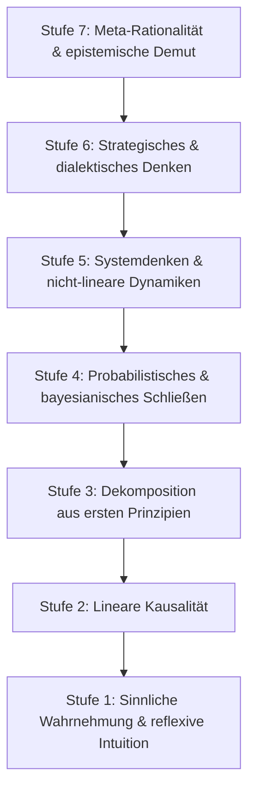

## Denken als Stufenbau der Abstraktion

Menschliches Urteilsvermögen ist kein starres Monolithikum und vollzieht sich nicht auf einer einzigen geistigen Ebene. Der menschliche Geist ist vielmehr ein vielschichtiges Gefüge des Verstehens, das die Wirklichkeit auf grundlegend unterschiedlichen Abstraktionsstufen erfasst.

Auf der elementarsten Stufe reagieren wir auf unmittelbare Sinneseindrücke mit biologischen Reflexen. Auf der höchsten Stufe richtet das Denken den Blick auf sich selbst, um die Grenzen, Voraussetzungen und Widersprüche der Rationalität selbst zu ergründen.

Wahre geistige Reife bemisst sich weder nach der schieren Denkgeschwindigkeit noch nach dem Anhäufen von Faktenwissen. Sie zeigt sich in der **epistemischen Weite: der bewussten Fähigkeit zu erkennen, welche logische Abstraktionsstufe eine konkrete Fragestellung erfordert, und sich zwischen diesen Stufen zu bewegen, ohne die Erdung im Wirklichen zu verlieren.**

Im Folgenden wird die Sieben-Stufen-Taxonomie des logischen Denkens dargelegt.

---

## Stufe 1: Sinnliche Wahrnehmung & reflexive Intuition

_Die instinktive Basis (System 1)._

- **Mechanismus:** Unmittelbare Reiz-Reaktions-Muster, somatische Marker, unterbewusster Musterabgleich und emotionale Heuristiken.
- **Merkmale:** Augenblicklich, unbewusst, mühelos und frei von vorangehendem Abwägen.
- **Funktion:** Unmittelbare Orientierung und Selbsterhaltung. Sie lässt den erfahrenen Seemann einen Witterungsumschwung ahnen, noch ehe das Barometer fällt, oder den Handwerker spüren, wann ein Werkstoff bricht.
- **Grenze:** Höchst anfällig für optische Täuschungen, Aktualitätsverzerrungen und kollektive Stimmungen. Intuition verdient nur dann Vertrauen, wenn sie durch jahrelange Erfahrung in stabilen Umwelten geschult wurde; in komplexen Lagen führt sie allzu oft in die Irre.

---

## Stufe 2: Lineare Kausalität (Deterministische Logik)

_Die mechanische Abfolge: WENN $A \implies B$._

- **Mechanismus:** Direkte, einkausale zeitliche Ursache-Wirkungs-Beziehung.
- **Merkmale:** Deterministisch, folgerichtig, mechanisch und aussagenlogisch.
- **Funktion:** Verständnis elementarer physikalischer Gesetze und einfacher Verhaltensregeln. Lässt man einen Stein fallen, beschleunigt er gen Boden. Bricht man ein Verbot, droht eine Strafe.
- **Grenze:** Versagt vollständig bei Rückkopplungsschleifen, zirkulären Verflechtungen oder zeitlichen Verzögerungen. Der lineare Denker verfällt leicht dem Fehlschluss der Monokausalität und vermutet hinter jedem komplexen Problem einen einzelnen Schuldigen.

---

## Stufe 3: Dekomposition aus ersten Prinzipien (Axiomatische Analyse)

_Kartesische Reduktion & methodischer Zweifel._

- **Mechanismus:** Das radikale Abstreifen überlieferter Konventionen, bequemer Analogien und des bloßen Hörensagens bis hin zu unhintergehbaren, fundamentalen Grundwahrheiten – um das Urteil von dort aus methodisch neu aufzubauen.
- **Merkmale:** Grundlegend, unnachgiebig, unabhängig von gesellschaftlichen Glaubenssätzen.
- **Historisches Vorbild:** René Descartes, der in seinen _Meditationen_ jede anzweifelbare Sinnesgewissheit verwarf, bis er auf den unerschütterlichen Grund des denkenden Ichs (_cogito, ergo sum_) stieß.
- **Funktion:** Durchbricht die Trägheit des _„Das haben wir schon immer so gemacht“_ und zwingt das Denken, auf sachlicher Notwendigkeit statt auf herkömmlicher Gewohnheit zu ruhen.

---

## Stufe 4: Probabilistisches & induktives Schließen (Bayesianische Epistemologie)

_Urteilen unter Ungewissheit: `P(H | E) = (P(E | H) · P(H)) / P(E)`._

- **Mechanismus:** Überzeugungen nicht als starre Schwarz-Weiß-Dogmen (wahr oder falsch) zu behandeln, sondern als gleitende Wahrscheinlichkeitsverteilungen, die beim Eintreffen neuer empirischer Befunde verhältnismäßig angepasst werden.
- **Merkmale:** Differenziert, abwägend, empfänglich für empirische Korrekturen und unempfänglich für Fanatismus.
- **Funktion:** Medizinische Diagnostik, empirische Forschung, historische Quellenkritik und Risikobewertung. Der probabilistische Denker verzichtet auf die Illusion absoluter Sicherheit und gewichtet seine Überzeugung anhand der Beleglage.
- **Kernfrage:** _„Wie hoch war meine ursprüngliche Zuversicht in diese Annahme, und wie wahrscheinlich wäre der neue Befund, wenn meine Hypothese tatsächlich unzutreffend wäre?“_

---

## Stufe 5: Systemdenken & nicht-lineare Dynamiken

_Die ganzheitliche Perspektive der Interdependenz._

- **Mechanismus:** Analyse von Beziehungsnetzen, verstärkenden und dämpfenden Rückkopplungsschleifen, zeitlichen Verzögerungen und emergenten Eigenschaften, die sich nicht aus der isolierten Betrachtung von Einzelteilen erklären lassen.
- **Merkmale:** Kontraintuitiv, mehrdimensional, dynamisch und zyklisch.
- **Klassischer Lehrsatz:** Der aristotelische Grundsatz, wonach _„das Ganze mehr ist als die Summe seiner Teile“_.
- **Zentrale Einsicht:** In komplexen Gefügen bewirkt der Eingriff an einem offensichtlichen Symptom oft das genaue Gegenteil der guten Absicht (Gesetz der unbeabsichtigten Nebenfolgen).

---

## Stufe 6: Strategisches & dialektisches Denken (Multi-Akteurs-Kognition)

_Die Ebene Geist zu Geist (Spieltheorie & Dialektik)._

- **Mechanismus:** Das vorausschauende Modellieren der Absichten anderer autonomer Akteure, die ihrerseits unsere eigenen Absichten, Interessen und Schritte mitbedenken.
- **Merkmale:** Dialektische Spannung, Informationsasymmetrien, Anreizstrukturen und Nash-Gleichgewichte.
- **Funktion:** Diplomatie, Verhandlungsführung, Staatskunst und tiefgründige philosophische Auseinandersetzung.
- **Kernhaltung:** Die Einsicht, dass Wirklichkeit stets durch widerstreitende Absichten geformt wird. Die Leitfrage lautet nicht mehr bloß _„Was ist mein idealer Weg?“_, sondern _„Wie wird die Gegenseite handeln, wenn sie meine Entscheidung erkennt, und welches Gleichgewicht wird daraus hervorgehen?“_

---

## Stufe 7: Meta-Rationalität & epistemische Demut

_Kognition zweiter Ordnung: Das Nachdenken über das Denken._

- **Mechanismus:** Die rekursive Prüfung der eigenen Denkwerkzeuge. Das Hinterfragen jener Paradigmen, Sprachmuster und unausgesprochenen Vorannahmen, die unseren Blick auf die Welt formen.
- **Merkmale:** Radikaler Selbstzweifel, geistige Beweglichkeit und wache Urteilskraft.
- **Grundprinzip:** **„Die Landkarte ist nicht die Landschaft“**. Jedes geistige Modell, so ausgefeilt es sein mag, ist bloß eine Abstraktion, die gewisse Aspekte hervorhebt, während sie andere unvermeidlich im Dunkeln lässt.
- **Funktion:** Überwindung von intellektuellem Hochmut. Der meta-rationale Geist begreift die gödelschen Grenzen formaler Systeme: Kein Denkmodell vermag jemals zugleich vollständig, widerspruchsfrei und der unerschöpflichen Fülle der Wirklichkeit vollkommen gewachsen zu sein.

---

## Orientierung im geistigen Stufenbau

Sinn wahrer geistiger Bildung ist es nicht, ununterbrochen in den luftigen Höhen der Stufe 7 zu verharren. Ein Dasein, das sich gänzlich in Meta-Überlegungen verliert, führt zu lebensfremder Lähmung und Unentschlossenheit.

Umgekehrt führt das dauerhafte Verharren auf den Stufen 1 und 2 zu Dogmatismus, Aberglauben und Verblendung.

**Weisheit besteht in der Beweglichkeit, das Denken der Wirklichkeit anzumessen:**

- Auf **Stufe 1** vertrauen bei akuter körperlicher Gefahr.
- Auf **Stufe 2** setzen für alltägliche Arbeitsabläufe und verlässliche Ordnung.
- Zu **Stufe 3** greifen, wenn hergebrachte Erklärungen scheitern.
- Auf **Stufe 4** bauen beim Abwägen widersprüchlicher Belege im Ungewissen.
- Zu **Stufe 5** aufsteigen bei der Bewältigung vielschichtiger, generationenübergreifender Fragen.
- Zu **Stufe 6** vordringen im Umgang mit widerstreitenden Interessen.
- Zu **Stufe 7** zurückkehren, um sich der eigenen Fehlbarkeit zu besinnen und die geistige Demut zu bewahren.
