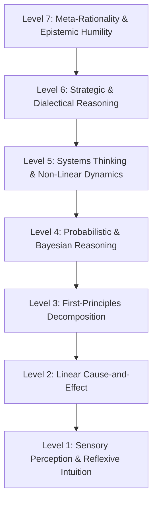

## Thought as an Architecture of Abstraction

Human reasoning is not a monolithic faculty. It does not operate at a single uniform depth. Rather, the mind is a multi-tiered architecture of understanding, capable of processing the world across fundamentally distinct strata of abstraction.

At the lowest tier, we react to immediate sensory stimuli with biological reflex. At the highest, the mind turns its gaze upon itself, evaluating the boundaries, limitations, and presuppositions of rationality itself.

Intellectual maturity is not defined by raw mental horsepower or speed of calculation. It is defined by **epistemic range: the conscious ability to identify which level of logical abstraction a problem demands, and to navigate fluidly between them without losing touch with reality.**

Here is the seven-tier taxonomy of logical cognition.

---

## Level 1: Sensory Perception & Reflexive Intuition

_The Instinctive Baseline (System 1)._

- **Mechanism:** Direct biological stimulus-response, somatic markers, subconscious pattern matching, and emotional heuristics.
- **Characteristics:** Instantaneous, subconscious, effortless, non-deliberative.
- **Function:** Immediate survival and rapid situational navigation. It allows an artisan to feel when a material is about to fracture, or a seasoned sailor to sense a shift in weather before looking at a barometer.
- **Limitation:** Highly susceptible to cognitive illusions, recency bias, and tribal panic. Intuition is trustworthy only when calibrated by thousands of hours of immersion in stable, low-noise environments. In novel or complex modern environments, unexamined intuition frequently misleads.

---

## Level 2: Linear Cause-and-Effect (Deterministic Logic)

_The Mechanical Sequence: IF $A \implies B$._

- **Mechanism:** Direct, single-variable chronological causality.
- **Characteristics:** Deterministic, sequential, mechanical, propositional.
- **Function:** Understanding direct physical agency and procedural rules. If you drop a stone from a cliff, it accelerates downward. If you violate a statutory code, a penalty is incurred.
- **Limitation:** Fails completely in the presence of feedback loops, circular causality, or delayed consequences. The linear thinker inevitably falls prey to the single-cause fallacy, assuming every complex societal or physical symptom must trace back to a single identifiable culprit.

---

## Level 3: First-Principles Decomposition (Axiomatic Analysis)

_Cartesian Reduction & Radical Skepticism._

- **Mechanism:** Stripping away inherited tradition, analogy, and conventional opinion until reaching irreducible, fundamental axioms—then methodically reconstructing conclusions upward.
- **Characteristics:** Foundational, rigorous, counter-conventional.
- **Historical Example:** René Descartes practicing methodical doubt in his _Meditations_, stripping away every sensory belief that could conceivably be doubted until arriving at the indubitable bedrock of the conscious self (_cogito, ergo sum_).
- **Function:** Shatters the intellectual inertia of _"this is how things have always been done."_ It forces reasoning to rest upon structural necessity rather than social consensus.

---

## Level 4: Probabilistic & Inductive Reasoning (Bayesian Epistemology)

_Reasoning Under Uncertainty: `P(H | E) = (P(E | H) · P(H)) / P(E)`._

- **Mechanism:** Treating beliefs not as absolute binary dogmas (true vs. false), but as continuous probability distributions that must be updated proportionally upon encountering new empirical evidence.
- **Characteristics:** Nuanced, calibrated, empirically humble, resistant to dogmatism.
- **Function:** Navigating medical diagnostics, scientific inquiry, financial risk, and historical analysis. The probabilistic thinker does not seek illusory 100% certainty; they calibrate confidence to the weight of evidence.
- **Core Practice:** Continually asking: _"What was my prior confidence in this proposition, and how likely would this new evidence be if the hypothesis were actually false?"_

---

## Level 5: Systems Thinking & Non-Linear Dynamics

_The Holistic Interdependence Tier._

- **Mechanism:** Analyzing networks of interdependent parts, balancing and reinforcing feedback loops, time delays, and emergent phenomena that cannot be deduced from isolated components.
- **Characteristics:** Counter-intuitive, multidimensional, cyclical, dynamic.
- **Historical Axiom:** Aristotle's dictum that _"the whole is greater than the sum of its parts."_
- **The Core Insight:** Interventions in complex systems frequently produce the opposite of their intended effect (the Law of Unintended Consequences). For example, subsidizing an inefficient agricultural practice to stabilize food prices may induce market distortions that bankrupt family farmers a decade later.

---

## Level 6: Strategic & Dialectical Reasoning (Multi-Agent Cognition)

_The Mind-to-Mind Tier (Game Theory & Dialectics)._

- **Mechanism:** Modeling the decisions of other autonomous, self-interested agents who are simultaneously modeling your own cognitive state, incentives, and future choices.
- **Characteristics:** Dialectical tension, incentive structures, asymmetric information, Nash equilibria.
- **Function:** Geopolitics, diplomacy, negotiation, military strategy, and philosophical debate.
- **The Core Practice:** Transcending passive analysis to recognize that reality is co-created by competing wills. One no longer asks merely _"What is the optimal path?"_ but _"How will the other party respond when they realize I have taken this path, and what equilibrium will emerge from our mutual interaction?"_

---

## Level 7: Meta-Rationality & Epistemic Humility

_Second-Order Cognition: Thinking About Thinking._

- **Mechanism:** The recursive examination of the cognitive frameworks themselves. Inspecting the paradigms, linguistic categories, and cultural assumptions that generate our models of the world.
- **Characteristics:** Radical self-skepticism, cognitive flexibility, epistemic vigilance.
- **Foundational Insight:** **"The map is not the territory."** Every mental model, no matter how sophisticated, is an abstraction that illuminates certain facets of reality while casting others into shadow.
- **Function:** Overcoming intellectual fanaticism. The meta-rational thinker understands the Gödelian limits of formal systems: no single conceptual framework can simultaneously be complete, consistent, and fully comprehend the richness of existence.

---

## Navigating the Cognitive Hierarchy

The goal of intellectual mastery is not to dwell permanently in the dizzying stratosphere of Level 7. Living exclusively in meta-cognition breeds philosophical paralysis, detachment, and an inability to participate in the practical demands of daily life.

Conversely, remaining trapped at Levels 1 and 2 produces dogmatism, superstition, and vulnerability to demagogues.

**True wisdom is the fluid capacity to calibrate the level of thought to the nature of the reality before you:**

- Rely on **Level 1** when dodging immediate physical danger.
- Apply **Level 2** for basic procedural clarity and mechanical consistency.
- Invoke **Level 3** when conventional explanations break down.
- Employ **Level 4** when evaluating conflicting evidence under uncertainty.
- Climb to **Level 5** when addressing systemic, multi-decade challenges.
- Elevate to **Level 6** when negotiating with competing human wills.
- Return to **Level 7** to ensure your intellectual pride has not blinded you to your own fallibility.
