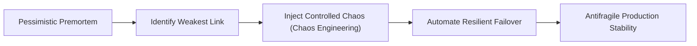

import RequestLab from "../../../components/blog/RequestLab.astro";

## The Toxic Optimism of the Happy Path

Most software architectures fail not because their creators lacked technical skill, but because they suffered from **toxic optimism**.

The happy-path diagram drawn on an office whiteboard assumes an idyllic universe: the network is infinitely reliable, latency is zero, downstream databases never lock, third-party payment gateways respond in 15 milliseconds, and users submit well-formed, sanitized payloads.

Reality is a relentless adversary. Hardware burns out, DNS servers partition, memory leaks accumulate over weeks, and traffic surges arrive at 03:00 on Sunday.

**Strategic pessimism** is the deliberate, rigorous practice of assuming that every subsystem, contract, and network link will fail under the worst possible circumstances — and engineering the system so that its survival does not depend on hope.

---

## 1. Stoic Roots: _Premeditatio Malorum_ in Engineering

In classical Stoic philosophy, thinkers like Seneca practiced **_premeditatio malorum_** — the premeditation of evils. Instead of hoping for tranquil fortunes, the Stoic mentally simulated exile, poverty, sickness, and betrayal so that when disaster struck, it found them prepared, fortified, and clear-eyed.

In systems engineering, strategic pessimism translates directly into **failure-driven architecture**:

> _"Do not design for how the system succeeds. Design for how the system degrades gracefully when everything collapses."_

The distinction between fatalism and strategic pessimism is profound:

- **Fatalism** says: _"Everything will break, so effort is futile."_
- **Strategic Pessimism** says: _"The network will partition and the replica will lag. Therefore, I will implement an idempotent write log, circuit breakers, and bounded backpressure today."_

---

## 2. Interactive Boundary Analysis: The Request Cost

When designing distributed boundaries, naive assumptions about latency and payload size compound rapidly. Test this reality in the interactive lab below by adjusting payload sizes and stepping through a distributed request:

<RequestLab />

Every network boundary introduced into an architecture incurs an inescapable physical tax. As demonstrated above, increasing payloads transforms benign local calls into severe throughput bottlenecks across database and API boundaries.

---

## 3. The 5 Pillars of Defensively Engineered Systems

### I. Bound Everything (No Infinite Queues)

An unbounded resource is a ticking memory bomb. If your message queue, thread pool, or HTTP connection pool has no hard upper ceiling, a downstream slowdown will exhaust heap space and trigger an unrecoverable crash.

- **Rule:** Every buffer must be bounded. When full, drop or reject requests early with HTTP `429 Too Many Requests` or `503 Service Unavailable`. Failing fast preserves system health.

### II. Timeouts, Circuit Breakers & Jittered Retries

A thread waiting indefinitely for a remote HTTP response is dead capital. When hundreds of threads hang on a stalled dependency, thread pool exhaustion takes down the entire parent service.

```text
Service A ──[HTTP Call]──> Broken Service B (Hangs 60s)
Result: All worker threads in Service A block and die within 10 seconds.
```

- **Solution:**
  1. **Strict Deadlines:** Never issue a network call without explicit read and connect timeouts (e.g., 500 ms).
  2. **Circuit Breaker:** If failure rates exceed 50% over a 10-second window, trip the breaker and fail instantly for 30 seconds without touching the network.
  3. **Full Jitter Retries:** Avoid retry storms. Use exponential backoff with full randomized jitter (`T = random(0, 2^attempt × base)`) to prevent synchronized waves of retry requests from overwhelming recovering services.

### III. Bulkheading (Blast Radius Isolation)

Named after the watertight compartments in nautical architecture: if water breaches one hull compartment, the bulkhead seals it off, keeping the ship afloat.

- **In Systems:** Never allow a failure in an auxiliary feature (e.g., PDF generation, user avatar processing, or analytics ingestion) to take down the primary transactional engine (checkout, authentication). Partition connection pools, worker queues, and CPU quotas independently.

### IV. Idempotency as a First-Class Primitive

In an imperfect network, the question is never _if_ a request will be resent, but _when_. Network packets drop on the return leg, causing clients to retry requests that the server actually processed.

- **Rule:** Every state-altering API call (charging a card, publishing an order) must require an `Idempotency-Key` stored in Redis or PostgreSQL with an atomic condition (`INSERT ... ON CONFLICT DO NOTHING`). Resending the same payload produces the same outcome without duplicate execution.

### V. The Premortem Ritual

Before committing an architectural design, convene the engineering team and declare:

> _"Imagine it is six months from now. Our system has suffered a catastrophic, business-ending outage in production. Spend 15 minutes writing down exactly how and why it happened."_

By liberating engineers from the pressure to sound positive, the premortem surfaces latent vulnerabilities that standard review processes overlook.

---

## 4. From Fragility to Antifragility

As Nassim Nicholas Taleb articulates, the opposite of fragile is not merely robust; it is **antifragile**.

A fragile system shatters under stress. A robust system resists stress. An **antifragile system** uses stress to discover weaknesses, eliminate them, and emerge stronger. Strategic pessimism is the engine of antifragility:



---

## Conclusion: The Paradox of the Skeptical Engineer

The most reliable systems in the world are built by engineers who trust nothing. They do not trust the network; they do not trust the database drivers; they do not trust their own code.

By rigorously designing for catastrophe, they earn the quiet, uninterrupted nights that carefree optimists never enjoy. In software systems engineering, **pessimism in design is the only true foundation for confidence in production**.
