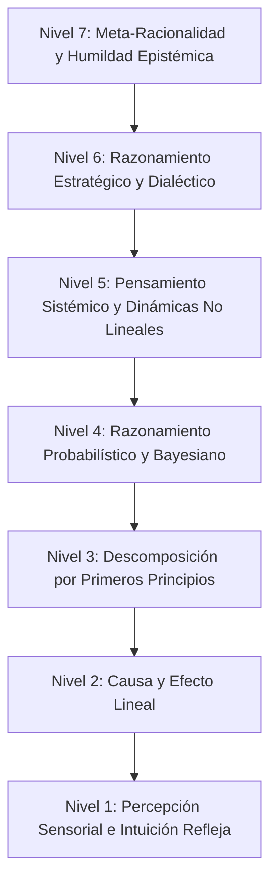

## El Pensamiento como Arquitectura de Abstracción

El razonamiento humano no constituye una facultad monolítica ni opera a una profundidad invariable. La mente es, en esencia, una arquitectura escalonada del entendimiento, capaz de procesar la realidad a través de estratos de abstracción cualitativamente distintos.

En el estrato más elemental reaccionamos ante estímulos sensoriales inmediatos mediante reflejos biológicos automáticos. En la cima, la mente vuelve la mirada hacia sí misma para interrogar los límites, las contradicciones y los presupuestos de la propia racionalidad.

La auténtica madurez intelectual no se mide por la velocidad de procesamiento ni por la agudeza memorística. Se define por la **amplitud epistémica: la capacidad consciente de discernir qué nivel de abstracción lógica exige un problema concreto y desplazarse con lucidez entre ellos sin perder el arraigo en lo real.**

A continuación se expone la taxonomía de los siete niveles del pensamiento lógico.

---

## Nivel 1: Percepción Sensorial e Intuición Refleja

_La Base Instintiva (Sistema 1)._

- **Mecanismo:** Respuesta directa ante estímulos biológicos, marcadores somáticos, reconocimiento subconsciente de patrones y heurísticas emocionales.
- **Características:** Instantáneo, subconsciente, espontáneo y carente de deliberación previa.
- **Función:** Supervivencia inmediata y orientación rápida. Es lo que permite a un artesano sentir la tensión exacta antes de que un material se quiebre, o a un navegante experimentado percibir un cambio de presión atmosférica antes de consultar el barómetro.
- **Límite:** Extremadamente vulnerable a los sesgos cognitivos, las ilusiones ópticas y las emociones colectivas. La intuición solo es fiable cuando ha sido calibrada por miles de horas de experiencia en entornos estables; en situaciones complejas o novedosas, dejarse guiar por la mera intuición conduce con frecuencia al error.

---

## Nivel 2: Causa y Efecto Lineal (Lógica Determinista)

_La Secuencia Mecánica: SI $A \implies B$._

- **Mecanismo:** Causalidad cronológica directa entre dos variables aisladas.
- **Características:** Determinista, secuencial, mecánico y proposicional.
- **Función:** Comprensión de leyes físicas básicas y reglas normativas simples. Si se suelta una piedra al vacío, cae aceleradamente. Si se infringe una norma de tránsito, se recibe una sanción.
- **Límite:** Fracasa ante fenómenos que presentan bucles de retroalimentación, causalidad circular o efectos demorados. El pensador lineal cae en la trampa de la causa única, asumiendo ingenuamente que todo problema social o físico complejo tiene un único culpable tangible.

---

## Nivel 3: Descomposición por Primeros Principios (Análisis Axiomático)

_Reducción Cartesiana y Escepticismo Metódico._

- **Mecanismo:** Despojar el problema de tradiciones heredadas, analogías prestadas y lugares comunes hasta aislar las verdades fundamentales irreductibles; a partir de ahí, reconstruir el juicio hacia arriba.
- **Características:** Fundacional, riguroso e independiente del dogma establecido.
- **Ejemplo Histórico:** René Descartes practicando la duda metódica en sus _Meditaciones Metafísicas_, desechando toda creencia sensorial susceptible de ser puesta en duda hasta alcanzar el suelo indestructible de la conciencia (_cogito, ergo sum_).
- **Función:** Rompe la inercia del _«así se han hecho siempre las cosas»_. Obliga a que las conclusiones descansen sobre necesidad lógica y evidencia, no sobre el peso del consenso social.

---

## Nivel 4: Razonamiento Probabilístico e Inductivo (Epistemología Bayesiana)

_Razonamiento bajo Incertidumbre: `P(H | E) = (P(E | H) · P(H)) / P(E)`._

- **Mecanismo:** Tratar las convicciones no como dogmas absolutos y binarios (verdadero frente a falso), sino como distribuciones de probabilidad que deben actualizarse en proporción directa a la nueva evidencia empírica.
- **Características:** Matizado, calibrado, humilde ante los datos y reacio al fanatismo.
- **Función:** Diagnóstico médico, investigación científica, análisis histórico y gestión del riesgo. El pensador probabilístico renuncia a la vana certeza del 100% y calibra su grado de adhesión según el peso de los indicios disponibles.
- **Práctica Clave:** Preguntarse sistemáticamente: _«¿Cuál era mi nivel previo de confianza en esta afirmación y con qué probabilidad aparecería esta nueva evidencia si mi hipótesis fuera falsa?»_

---

## Nivel 5: Pensamiento Sistémico y Dinámicas No Lineales

_La Perspectiva Holística y la Interdependencia._

- **Mecanismo:** Análisis de redes de componentes interconectados, bucles de retroalimentación (de refuerzo y de equilibrio), retardos temporales y propiedades emergentes que no pueden deducirse examinando las partes de forma aislada.
- **Características:** Contraintuitivo, multidimensional, cíclico y dinámico.
- **Axioma Clásico:** El principio aristotélico de que _«el todo es mayor que la suma de sus partes»_.
- **La Lección Central:** En los sistemas complejos, intervenir sobre un síntoma visible suele desencadenar efectos opuestos a los deseados (la Ley de Consecuencias Imprevistas). Subvencionar una actividad económica ineficiente para estabilizar el empleo a corto plazo puede terminar arruinando a toda la industria una década más tarde.

---

## Nivel 6: Razonamiento Estratégico y Dialéctico (Cognición Multi-Agente)

_La Dimensión Mente a Mente (Teoría de Juegos y Dialéctica)._

- **Mecanismo:** Modelar las decisiones de otros agentes autónomos e inteligentes que, a su vez, están modelando activamente nuestra propia mente, nuestros intereses y nuestros posibles movimientos.
- **Características:** Tensión dialéctica, asimetría de información, análisis de incentivos y equilibrios de Nash.
- **Función:** Geopolítica, diplomacia, negociación, estrategia militar y debate filosófico profundo.
- **Práctica Clave:** Superar el análisis estático y entender que la realidad está forjada por voluntades en pugna. Ya no basta con preguntarse _«¿Cuál es el camino óptimo?»_, sino _«¿Cómo reaccionará la otra parte al descubrir que he tomado este rumbo y qué equilibrio emergerá de nuestra interacción mutua?»_

---

## Nivel 7: Meta-Racionalidad y Humildad Epistémica

_Cognición de Segundo Orden: Pensar sobre el Pensamiento._

- **Mecanismo:** El examen recursivo de los propios marcos conceptuales. Cuestionar los paradigmas, las categorías lingüísticas y los sesgos culturales que dan forma a nuestra comprensión del mundo.
- **Características:** Autoescepticismo radical, flexibilidad cognitiva y vigilancia crítica permanente.
- **Principio Fundamental:** **«El mapa no es el territorio»**. Toda teoría mental, por sofisticada que sea, es solo una abstracción que ilumina ciertos aspectos de la realidad mientras arroja inevitablemente otros a la penumbra.
- **Función:** Trascender el dogmatismo intelectual. Quien alcanza la meta-racionalidad comprende los límites inherentes a todo sistema formal (al estilo de Gödel): ningún marco conceptual humano puede ser simultáneamente completo, libre de paradojas y capaz de agotar la infinita riqueza del existir.

---

## Navegación por la Jerarquía Cognitiva

El propósito de la excelencia intelectual no es habitar perpetuamente en la estratosfera del Nivel 7. Vivir recluido en la meta-cognición engendra parálisis filosófica, desarraigo y una absoluta inoperancia ante las exigencias prácticas de la vida.

Por el contrario, quedar estancado en los Niveles 1 y 2 conduce al dogmatismo, a la superstición y a la manipulación por parte de terceros.

**La verdadera sabiduría consiste en la ductilidad de calibrar el nivel de pensamiento a la naturaleza del desafío:**

- Apelar al **Nivel 1** ante una amenaza física súbita.
- Emplear el **Nivel 2** para la claridad procedimental y el orden cotidiano.
- Recurrir al **Nivel 3** cuando las respuestas heredadas se revelan insuficientes.
- Aplicar el **Nivel 4** al sopesar evidencias contradictorias en contextos inciertos.
- Elevarse al **Nivel 5** para afrontar dilemas estructurales y de largo plazo.
- Ascender al **Nivel 6** al interactuar con voluntades humanas en conflicto.
- Descansar en el **Nivel 7** para recordar que nuestra propia razón es imperfecta y mantener encendida la llama de la humildad.
