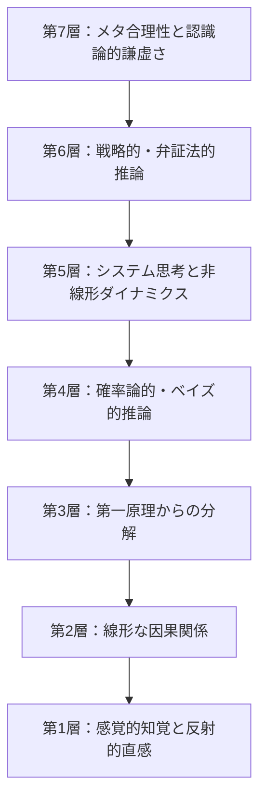

## 抽象度のアーキテクチャとしての思考

人間の思考力は単一の平坦な機能ではなく、一定の深さだけで完結するものでもありません。人間の精神とは、本質的に何層もの理解の地層からなるアーキテクチャであり、現象をまったく異なる抽象度において捉える能力を備えています。

最も基礎的な地層において、私たちは直接的な感覚刺激に対して生物学的な反射で応じます。そして最高次の地層において、理性は自らに視線を向け、合理性そのものの前提や限界、そして構造的な矛盾を問い直します。

真の知的成熟とは、計算速度の速さや知識の多さによって決まるものではありません。**認識論的な幅広さ——目の前の問題がいかなる論理的抽象度を要求しているかを見極め、現実を見失うことなくその階層間を柔軟に行き来できる能力**こそが、真の知性を決定づけます。

以下に、論理的認知における7つの階層の体系を示します。

---

## 第1層：感覚的知覚と反射的直感

_本能的な基盤（システム1）。_

- **メカニズム：** 直接的な生体反応、身体的マーカー、潜在意識下のパターン照合、感情的ヒューリスティクス。
- **特徴：** 瞬間的、無意識的、自動的であり、事前の熟慮を要しない。
- **機能：** 生存のための即時的判断。熟練の船乗りが気圧計を見る前に嵐の気配を察知したり、職人が素材のわずかな軋みから破断を予感したりする感覚。
- **限界：** 認知バイアスや集団心理の煽りに極めて脆弱。直感が有効に機能するのは、安定した環境で長年の試行錯誤を重ねた領域に限られ、複雑な現代の課題において盲目的な直感は誤断を招きます。

---

## 第2層：線形な因果関係（決定論的論理）

_機械的な連鎖：もし $A$ ならば $B$。_

- **メカニズム：** 単一の変数間における直接的・時系列的な因果律。
- **特徴：** 決定論的、逐次的、機械的、命題論理的。
- **機能：** 基礎的な物理法則や社会規範の理解。石を手放せば地面へと落下し、明確な規則に違反すれば相応の罰則が科されます。
- **限界：** フィードバック・ループ（循環的な相互作用）や時間的な遅れを伴う現象の前では完全に破綻します。線形思考に囚われた人間は「単一原因の誤謬」に陥り、あらゆる複雑な社会問題に対して単純な単一の元凶を探そうとしてしまいます。

---

## 第3層：第一原理からの分解（公理的分析）

_デカルト的方法的懐疑と根源的還元。_

- **メカニズム：** 伝聞や慣習、安易な類推を徹底的に削ぎ落とし、疑い得ない不可分な基本公理へと還元した上で、演繹的に思考を再構築する。
- **特徴：** 根源的、厳密、常識に囚われない独立性。
- **歴史的実例：** ルネ・デカルトが『省察』において、少しでも疑い得るすべての感覚的確信を退け、思考する我の存在（_cogito, ergo sum_）という確固たる岩盤へと到達した試み。
- **機能：** 「これまでずっとこうしてきたから」という知的惰性を粉砕し、思考を世間の空気ではなく論理的必然性の上に打ち立てます。

---

## 第4層：確率論的・帰納的推論（ベイズ的認識論）

_不確実性下での思考：`P(H | E) = (P(E | H) · P(H)) / P(E)`。_

- **メカニズム：** 信念を「真か偽か」という二元論的な教条ではなく、新たな経験的証拠の獲得に応じて連続的に更新される「確率分布」として扱う。
- **特徴：** 柔軟、実証主義的、独善を退ける謙虚さ。
- **機能：** 医療診断、科学的検証、歴史分析、リスク管理。確率論的思考者は100％の絶対的確信という幻想を捨て、証拠の確かさに応じて確信の度合いを客観的に調整します。
- **本質的な問い：** 「この仮説に対するこれまでの確信度はどれほどであり、もし仮説が誤りであった場合、この新たな証拠が観測される確率はどれほどか？」

---

## 第5層：システム思考と非線形ダイナミクス

_全体論的相互依存の地層。_

- **メカニズム：** 構成要素のネットワーク、自己強化・平衡化のフィードバック循環、時間的遅延、そして個々の要素の分析からは予測できない創発的性質（エマージェンス）を分析する。
- **特徴：** 直感に反する、多次元的、周期的、動的。
- **古代の格言：** アリストテレスが説いた「全体は部分の総和以上のものである」という洞察。
- **核心的教訓：** 複雑なシステムにおいて、目先の表面的な兆候だけに介入すると、往々にして意図とは正反対の破滅を招く（予期せぬ結果の法則）。

---

## 第6層：戦略的・弁証法的推論（マルチエージェント認知）

_知性と知性の対峙（ゲーム理論と弁証法）。_

- **メカニズム：** こちらの出方や思惑を同時に予測して動く、他の自律的で理性的なアクターたちの意思決定プロセスを多層的にモデリングする。
- **特徴：** 弁証法的緊張、情報の非対称性、インセンティブ構造、ナッシュ均衡。
- **機能：** 外交交渉、地政学、紛争解決、そして高次元の哲学的対話。
- **本質的な視点：** 現実は対立する意志の相互作用によって紡がれるという自覚。「自分にとっての最善手は何か」にとどまらず、「自分がこの一手を打ったことを相手が知ったとき、相手はどう反応し、いかなる均衡が生まれるか」を思考する。

---

## 第7層：メタ合理性と認識論的謙虚さ

_二次認知：思考についての思考。_

- **メカニズム：** 思考の枠組みそのものを再帰的に検証すること。私たちが世界を解釈するために用いている前提、言語の構造、文化的偏見そのものを疑う。
- **特徴：** 根源的な自己懐疑、認知的柔軟性、研ぎ澄まされた警戒心。
- **基本原則：** **「地図は現地そのものではない」**。いかに精巧な精神的モデルであっても、それは現実の一側面を照らし出すと同時に、別の側面を不可避的に覆い隠す抽象化に過ぎない。
- **機能：** 知的独善の克服。ゲーデルの不完全性定理が示すように、いかなる形式体系もそれ自身だけで完全無欠であり続けることはできず、世界の無限の豊穣さを包括し尽くすことはできないという境地。

---

## 認知階層の統合的運用

知的な卓越とは、第7層の高みに引きこもり続けることではありません。メタ認知の世界だけに安住することは、現実の行動から乖離した無為と冷笑主義を生み出します。

逆に、第1層や第2層だけに固執することは、偏狭な教条主義や迷信に身を委ねることになります。

**真の知恵とは、直面する現実の性質に応じて、思考の階層を自在に使い分ける柔軟性に宿ります。**

- 身体的な危機に直面したときは**第1層**の直感に身を委ねる。
- 日常の手続きや秩序の維持には**第2層**の明晰な線形論理を用いる。
- 従来の前提が立ち行かなくなったときは**第3層**の第一原理へ立ち返る。
- 不確実な証拠が交錯する局面では**第4層**の確率論で冷静に重みづける。
- 複雑な社会的課題には**第5層**のシステム全体を見渡す。
- 利害が対立する人間同士の交渉では**第6層**の戦略的相互作用を読む。
- そして自らの理性の傲慢を戒め、謙虚さを保つために**第7層**へと立ち返る。
