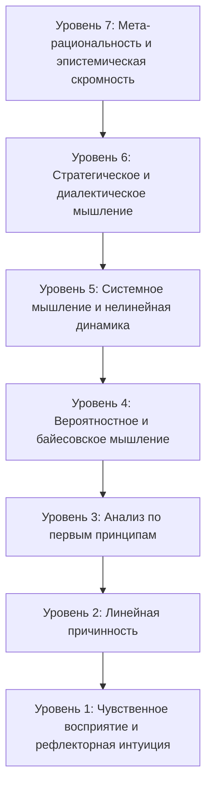

## Мышление как архитектоника абстракций

Человеческое мышление не является монолитной способностью и не протекает на одной постоянной глубине. Разум человека — это многоярусная архитектоника понимания, способная обрабатывать реальность на принципиально различных стратах абстракции.

На самом элементарном уровне мы отвечаем на непосредственные раздражители автоматическими биологическими рефлексами. На вершине — мысль обращается на саму себя, исследуя границы, допущения и противоречия рациональности как таковой.

Подлинная интеллектуальная зрелость измеряется не скоростью устных вычислений и не накоплением сухих сведений. Она определяется **эпистемическим диапазоном: осознанной способностью точно определять, какого уровня абстракции требует возникшая задача, и свободно перемещаться между этими уровнями, не отрываясь от почвы реальности.**

Ниже представлена система семи уровней логического мышления.

---

## Уровень 1: Чувственное восприятие и рефлекторная интуиция

_Инстинктивный базис (Система 1)._

- **Механизм:** Прямая реакция на внешние раздражители, соматические маркеры, подсознательное сопоставление образов и эмоциональные эвристики.
- **Характеристики:** Мгновенный, неосознанный, автоматический, не требующий предварительного размышления.
- **Функция:** Непосредственное выживание и оперативная ориентация в среде. Это то, что позволяет опытному мореплавателю почувствовать перемену погоды ещё до взгляда на барометр, или мастеру — ощутить предельное напряжение материала кончиками пальцев.
- **Границы применимости:** Крайняя уязвимость перед оптическими иллюзиями, когнитивными искажениями и стадным чувством. Интуиция надёжна лишь тогда, когда она годами калибровалась в стабильной среде; в сложных и многофакторных ситуациях слепое доверие чутью ведёт к катастрофическим ошибкам.

---

## Уровень 2: Линейная причинность (Детерминированная логика)

_Механическая последовательность: ЕСЛИ $A \implies B$._

- **Механизм:** Прямая хронологическая связь между двумя изолированными факторами.
- **Характеристики:** Детерминированный, последовательный, механический, пропозициональный.
- **Функция:** Понимание фундаментальных законов физики и простых правил общежития. Если выпустить камень из руки, он упадёт на землю. Если нарушить прямое установление закона, последует наказание.
- **Границы применимости:** Полностью бессилен перед явлениями, содержащими петли обратной связи, круговую причинность или временные задержки. Линейный мыслитель неизбежно становится жертвой ошибки монокаузальности — веры в то, что у любой сложной проблемы всегда есть один-единственный виновник.

---

## Уровень 3: Анализ по первым принципам (Аксиоматическая редукция)

_Картезианское сомнение и сведение к первоосновам._

- **Механизм:** Последовательное очищение предмета от унаследованных догм, приблизительных аналогий и авторитетных мнений вплоть до достижения фундаментальных, несомненных истин — с последующей дедуктивной реконструкцией вывода.
- **Характеристики:** Фундаментальный, строгий, бескомпромиссный по отношению к общественным штампам.
- **Исторический пример:** Рене Декарт в своих _«Размышлениях о первой философии»_, отбросивший все сомнительные чувственные верования, пока не нащупал гранитное основание мыслящего субъекта (_cogito, ergo sum_).
- **Функция:** Разрушает губительную инерцию _«так было заведено испокон веков»_. Заставляет суждение опираться на внутреннюю логическую необходимость, а не на силу привычки.

---

## Уровень 4: Вероятностное и индуктивное мышление (Байесовская эпистемология)

_Мышление в условиях неполноты информации: `P(H | E) = (P(E | H) · P(H)) / P(E)`._

- **Механизм:** Отношение к собственным убеждениям не как к абсолютным бинарным догмам (истина против лжи), а как к непрерывным распределениям вероятностей, обновляемым пропорционально поступающим эмпирическим свидетельствам.
- **Характеристики:** Взвешенный, самокритичный, открытый к фактам, чуждый фанатизму.
- **Функция:** Медицинская диагностика, научный эксперимент, историческая критика источников и управление рисками. Вероятностный мыслитель отказывается от иллюзии 100-процентной непогрешимости и калибрует уверенность сообразно весу улик.
- **Ключевой вопрос:** _«Какова была моя исходная уверенность в гипотезе и насколько вероятно было бы наблюдать этот новый факт, если бы гипотеза на самом деле была ложна?»_

---

## Уровень 5: Системное мышление и нелинейная динамика

_Холистический взгляд и взаимозависимость._

- **Механизм:** Анализ сетей взаимодействующих элементов, усиливающих и балансирующих петель обратной связи, задержек во времени и эмерджентных свойств, которые принципиально не сводятся к свойствам отдельных изолированных частей.
- **Характеристики:** Контринтуитивный, многомерный, циклический, динамический.
- **Классический афоризм:** Принцип Аристотеля: _«Целое больше, чем сумма его частей»_.
- **Главный урок:** В сложных системах грубое вмешательство в поверхностный симптом часто порождает эффект, прямо противоположный намерениям (Закон непреднамеренных последствий).

---

## Уровень 6: Стратегическое и диалектическое мышление (Мультиагентная когниция)

_Взаимодействие разумов (Теория игр и диалектика)._

- **Механизм:** Моделирование решений других автономных и разумных участников, которые одновременно просчитывают наши собственные цели, намерения и вероятные шаги.
- **Характеристики:** Диалектическое напряжение, асимметрия информации, баланс стимулов, равновесия Нэша.
- **Функция:** Дипломатия, государственное управление, искусство переговоров и глубокий философский спор.
- **Ключевой принцип:** Понимание того, что реальность творится столкновением воль. Вопрос звучит уже не просто _«Каков мой идеальный маршрут?»_, а _«Как поступит другая сторона, когда поймёт мой маневр, и к какому равновесию приведёт наше встречное движение?»_

---

## Уровень 7: Мета-рациональность и эпистемическая скромность

_Мышление второго порядка: Мысль о мысли._

- **Механизм:** Рекурсивный анализ самих познавательных инструментов. Исследование концептуальных парадигм, языковых структур и культурных фильтров, сквозь которые мы смотрим на мир.
- **Характеристики:** Радикальный самоскепсис, гибкость восприятия, постоянная бдительность ума.
- **Фундаментальный принцип:** **«Карта — не территория»**. Любая модель, сколь бы совершенной она ни казалась, остаётся абстракцией, высвечивающей одни грани бытия и неизбежно уводящей в тень другие.
- **Функция:** Преодоление интеллектуального высокомерия. Понимание гёделевских пределов формальных систем: ни одна замкнутая концептуальная схема не способна быть одновременно полной, непротиворечивой и вмещающей в себя неисчерпаемую глубину мироздания.

---

## Навигация по когнитивной иерархии

Цель интеллектуального развития не в том, чтобы запереться в ледяных высотах Седьмого уровня. Жизнь, проведённая исключительно в мета-рассуждениях, рождает бесплодный паралич, отчуждение и бессилие перед живой действительностью.

Но и застревание на Первом и Втором уровнях обрекает человека на слепой догматизм, суеверия и покорность манипуляциям.

**Подлинная мудрость — это способность соизмерять уровень мышления с характером предстоящего вызова:**

- Доверяйте **Уровню 1** при внезапной физической угрозе.
- Используйте **Уровень 2** для поддержания ясности повседневных правил и порядка.
- Обращайтесь к **Уровню 3**, когда привычные объяснения заходят в тупик.
- Применяйте **Уровень 4** при оценке противоречивых фактов в тумане неопределенности.
- Восходите к **Уровню 5** при решении системных долгосрочных задач.
- Подключайте **Уровень 6** в диалоге с чужой разумной волей.
- Возвращайтесь к **Уровню 7**, чтобы напомнить себе о собственной погрешимости и сохранить священную скромность ума.
